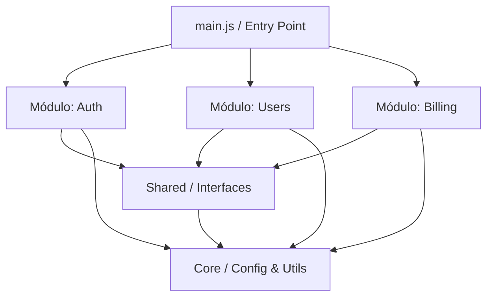

---
# REVISÃO TEÓRICA DOS CONCEITOS APRENDIDOS DURANTE A MINHA LEITURA DO LIVRO:
## ENGENHARIA DE SOFTWARE - UMA ABORDAGEM PROFISSIONAL
## AUTORES: ROGER S. PRESSMAN & BRUCE R. MAXIM

# PROCESSOS DE SOFTWARE

---
# MODELAGEM DE SOFTWARE

## Modularidade de Software
A modularização de um software é o processo de separar a funcionalidade de um programa em módulos
independentes, fazendo com que cada módulo possua o necessário para executar apenas um aspecto da 
funcionalidade desejada. Essa estratégia permite adicionar módulos menores e independentes em um 
programa, sem afetar outras funções. 
Este conceito é a base da arquitetura de microsserviços, que decompõe o domínio de negócio em pequenos
blocos. A implementação desses microsserviços consiste em padrões de design divididos em categorias
como aplicação, redes, infraestrutura, banco de dados, etc. e cada unidade sendo executada dentro do
seu próprio processo. A modularização permite a diminuição do tempo de desenvolvimento, permite baixo 
acoplamento e maior agilidade no ponto de vista de mudanças. Logo abaixo está descrito um exemplo de arquitetura
modular.

---
## 1. Estrutura de Diretórios

A organização abaixo ilustra um padrão clássico de modularização por camadas e domínios:

```text
projeto-raiz/
├── src/
│   ├── core/                  # Núcleo da aplicação (configurações, constantes, utils)
│   │   ├── config/
│   │   └── utils/
│   ├── modules/               # Módulos funcionais independentes (Domínios)
│   │   ├── auth/              # Módulo de Autenticação
│   │   │   ├── controllers/
│   │   │   ├── services/
│   │   │   ├── models/
│   │   │   └── index.js
│   │   ├── users/             # Módulo de Usuários
│   │   │   ├── controllers/
│   │   │   ├── services/
│   │   │   ├── models/
│   │   │   └── index.js
│   │   └── billing/           # Módulo de Pagamentos
│   │       ├── controllers/
│   │       ├── services/
│   │       ├── models/
│   │       └── index.js
│   ├── shared/                # Componentes, interfaces e helpers compartilhados
│   └── main.js                # Ponto de entrada (Entry Point)
├── tests/                     # Testes unitários e de integração espelhando src/
├── package.json
└── README.md
```

---

## 2. Diagrama de Dependências

O fluxo abaixo demonstra como os módulos se comunicam sem criar acoplamento circular:



---

## 3. Responsabilidade de cada Camada

| Camada / Diretório | Responsabilidade Principal | Regra de Dependência |
| :--- | :--- | :--- |
| **`core/`** | Configurações globais, conexão com banco de dados e utilitários puros. | Não depende de nenhum outro módulo interno. |
| **`shared/`** | Tipos, interfaces, middlewares e componentes reutilizáveis entre domínios. | Pode depender apenas de `core/`. |
| **`modules/`** | Regras de negócio isoladas por contexto (ex.: `auth`, `users`, `billing`). | Consome `shared/` e `core/`; evita importar diretamente arquivos internos de outros módulos. |
| **`main.js`** | Inicializa o servidor/aplicação e conecta os módulos principais. | Orquestra os módulos de alto nível. |


---

## 4. Boas Práticas de Modularização

1. **Alta Coesão:** Cada módulo deve agrupar arquivos que mudam pelos mesmos motivos.
2. **Baixo Acoplamento:** Exponha apenas o necessário através de um arquivo de interface pública (ex.: `index.js` ou `public-api.ts`).
3. **Inversão de Dependência:** Módulos de negócio devem depender de abstrações (`shared/`), não de implementações concretas de terceiros.
4. **Isolamento de Testes:** Cada módulo deve ser testável de forma independente, utilizando *mocks* para dependências externas.

---
# GESTÃO DA QUALIDADE

---
# GERENCIAMENTO DE PROJETOS DE SOFTWARE

---
